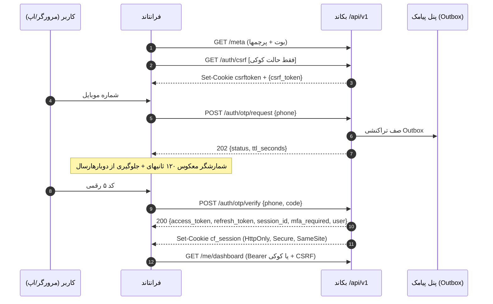
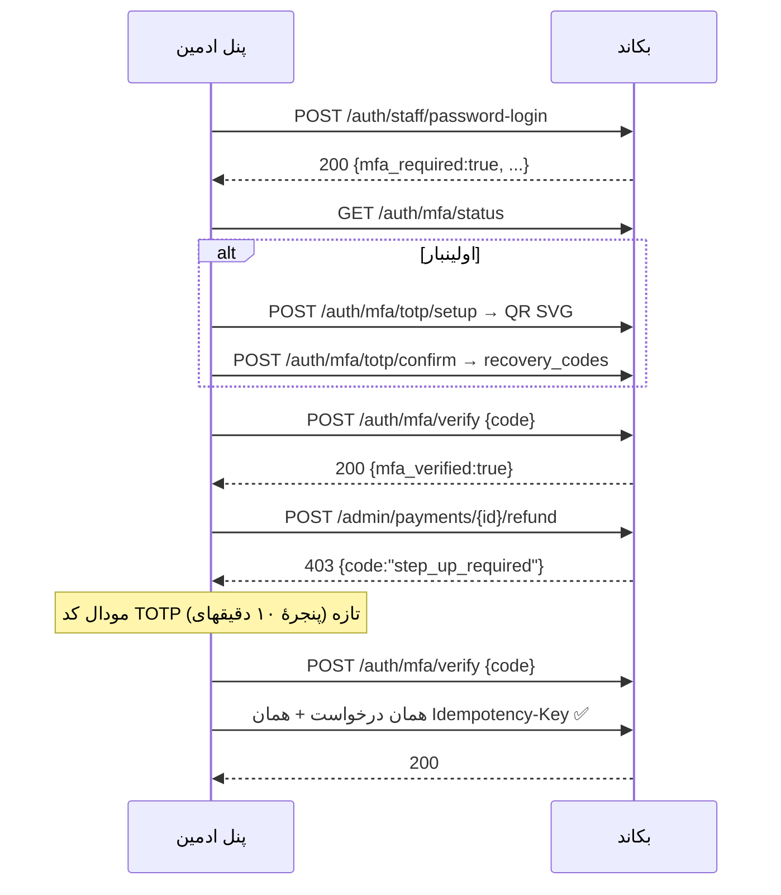
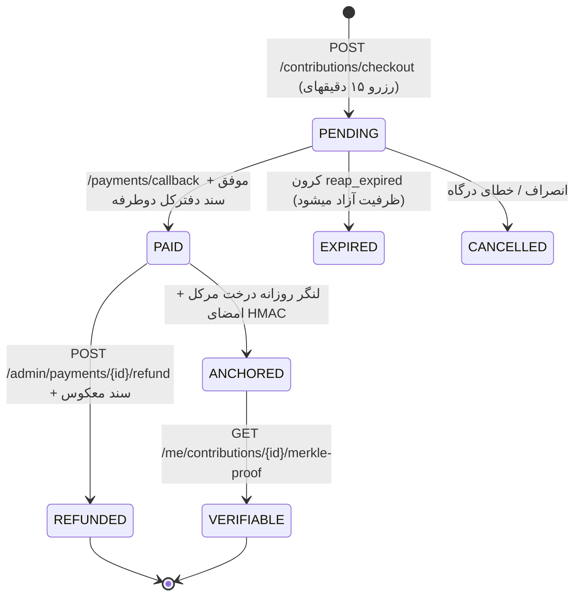

# 📦 سند رسمی تحویل بکاند به تیم فرانتاند — نسخهٔ ۱٫۱٫۰

> **وضعیت:** ✅ نهایی، قفلشده با قرارداد و تستشده روی CI
> **منبع حقیقت واحد:** [`docs/api/v1/openapi.yaml`](../api/v1/openapi.yaml) — OpenAPI 3.1.0 با **صفر هشدار**
> **مخاطب:** توسعهدهندگان وب (React / Next / Vue / Svelte)، موبایل (React Native / Flutter) و پنل ادمین
> **زبان رابط:** فارسی، راستبهچپ، تقویم شمسی، واحد پول ریال/تومان

---

## ۰. شروع ۵ دقیقهای

```bash
# ۱) دریافت مخزن و اجرای بکاند بهصورت محلی
git clone https://github.com/mohebbibrothers/Crowdfunding-Back.git
cd Crowdfunding-Back
make install          # uv sync --frozen --all-extras
make migrate          # MariaDB + جدول کش اتمیک
make seed             # دادههای نمایشی: خیریه، حرکت، قلک، حسابهای دفترکل
make run              # http://localhost:8000

# ۲) کاوش تعاملی
# Swagger UI : http://localhost:8000/api/v1/docs
# ReDoc     : http://localhost:8000/api/v1/redoc
# Schema    : http://localhost:8000/api/v1/schema
```

```bash
# ۳) کپی بستهٔ فرانتاند به پروژهٔ خود
cp -r docs/frontend ../my-frontend/src/api

# ۴) بازتولید داراییها و بررسی تایپها پس از هر تغییر قرارداد
make handoff
make tscheck     # npx --yes --package typescript@5.9.3 tsc --noEmit -p docs/frontend/tsconfig.json
```

> در محیط توسعه `EXPOSE_DEV_OTP_CODE=true` است؛ کد OTP در پاسخ `POST /api/v1/auth/otp/request`
> برگردانده میشود تا بدون پنل پیامک بتوانید جریان ورود را تست کنید. درگاه پیشفرض `sandbox`
> است و نیازی به merchant ID زرینپال ندارد.

---

## ۱. فهرست داراییهای تحویلی

| فایل | کاربرد | تولید |
| --- | --- | --- |
| [`api/v1/openapi.yaml`](../api/v1/openapi.yaml) | قرارداد ماشینی کامل: ۷۲ مسیر، ۸۳ عملیات، ۱۱۲ اسکیما | خودکار از کد (CI قفل میکند) |
| [`api/v1/README.md`](../api/v1/README.md) | قراردادهای سراسری پروتکل و نقشهٔ دامنهها | دستی + راستیآزمایی CI |
| [`ENDPOINTS.md`](./ENDPOINTS.md) | ماتریس کامل متد/مسیر/operationId/سطح دسترسی | 🟢 خودکار |
| [`ERRORS.md`](./ERRORS.md) | کاتالوگ ۳۸ کد خطای RFC 9457 + اقدام UX برای هر کد | 🟢 خودکار |
| [`api-types.d.ts`](./api-types.d.ts) | تایپهای TypeScript تمام اسکیماها + `ApiOperationMap` | 🟢 خودکار |
| [`operations.ts`](./operations.ts) | نگاشت `operationId → (method, path)` | 🟢 خودکار |
| [`api-client.ts`](./api-client.ts) | کلاینت fetch تایپشده: CSRF، JWT، refresh، خطا، retry، ETag، pagination | دستنویس |
| [`postman_collection.json`](./postman_collection.json) | ۸۳ درخواست آماده در ۲۳ پوشه؛ import مستقیم در Postman/Bruno/Insomnia | 🟢 خودکار |
| [`contract-fingerprint.json`](./contract-fingerprint.json) | SHA-256 قرارداد؛ CI با آن از همگامی داراییها مطمئن میشود | 🟢 خودکار |
| [`READINESS-AUDIT.md`](./READINESS-AUDIT.md) | ممیزی مستقل آمادگی: ۳ نقص مسدودکنندهٔ کشف‌شده با پروب واقعی + اثبات رفع | دست‌نویس |
| [`CHECKLIST.md`](./CHECKLIST.md) | چکلیست پذیرش (Definition of Done) قبل از استقرار فرانت | دستنویس |
| [`index.html`](./index.html) | پورتال بصری آفلاین خلاصهٔ تحویل (بدون نیاز به سرور/CDN) | دستنویس |
| [`README.md`](./README.md) | نقشهٔ ورودی بسته و فلسفهٔ «قرارداد یکبار، همهجا» | دستنویس |
| [`tsconfig.json`](./tsconfig.json) + [`type-tests.ts`](./type-tests.ts) | پیکربندی `strict` و تست کامپایلتایم تایپها | دستنویس |

> 🟢 یعنی **هیچگاه دستکاری نشوند**: `scripts/build_frontend_kit.py` آنها را مستقیماً از
> `openapi.yaml` و کاتالوگ `PROBLEM_CODES` میسازد. CI هرگونه درفت را با `diff` رد میکند.

---

## ۲. قراردادهای سراسری (باید پیش از نوشتن اولین کامپوننت خوانده شود)

### ۲٫۱ نشانی، نسخه و هدرها

| موضوع | مقدار |
| --- | --- |
| پیشوند همهٔ مسیرها | `/api/v1/` |
| نسخههای پشتیبانی‌شده | `["v1"]` (از `GET /api/v1/meta`) |
| نسخهٔ استقراری بکاند | `app_version` همان پاسخ `/meta` (مثلاً `1.1.0`)؛ در گزارش خطا ثبت شود |
| `Content-Type` درخواست | `application/json` (فقط JSON؛ فرم/ multipart پذیرفته نیست) |
| `Content-Type` خطا | **`application/problem+json`** (RFC 9457) |
| `X-Request-ID` | ارسال اختیاری (۸–۶۴ کاراکتر امن)؛ سرور همان را در پاسخ و `trace_id` خطاها برمیگرداند |
| `X-Response-Time-ms` | هدر پاسخ برای پایش کارایی |
| `If-None-Match` | روی `GET`های قابل کش؛ پاسخ `304 Not Modified` محتمل است |
| `ETag` | همراه پاسخهای نسخهدار (meta، فهرست حرکتها، خیریهها، قلکها) |
| `Idempotency-Key` | UUID روی تمام متدهای نوشتنی مالی؛ پاسخ بازپخششده هدر `X-Idempotent-Replayed: true` دارد |
| `X-CSRFToken` | فقط در حالت کوکی؛ مقدار از `GET /api/v1/auth/csrf` — **پس از هر ورود/خروج/refresh عوض می‌شود** |
| `Retry-After` | هدر پاسخهای `429` و `503` |

### ۲٫۲ پول: ریال صحیح، نمایش تومان

- **ورودی** مبالغ آزاد (قلک عام) همیشه **ریال و عدد صحیح مضرب ۱۰** است: `amount_rial: 1500000`.
- در حرکتهای سهممحور **مبلغ ارسال نمیشود**؛ فقط `shares_count` میفرستید و سرور از `share_price_rial` محاسبه میکند.
- **خروجی** هر مبلغ دوتایی است: `amount_rial` **و** `amount_toman`. فرانتاند فقط `*_toman` را نمایش دهد و
  هرگز خودش تقسیم بر ۱۰ نکند (گردکردن و خطاهای اعشاری ممنوع).
- قالب نمایش پیشنهادی: `Intl.NumberFormat("fa-IR")` + پسوند «تومان».

### ۲٫۳ تاریخ، شناسهها و جهت

- همهٔ `created_at` / `paid_at` / ... **ISO-8601 با انحراف منطقهٔ زمانی سامانه** هستند؛
  مثلاً `2026-11-14T10:53:28.017969+03:30`. هرگز فرض نکنید رشته با `Z` تمام می‌شود:
  همیشه `new Date(value)` بدهید و با `Intl.DateTimeFormat("fa-IR", { timeZone: "Asia/Tehran" })`
  یا فیلد آمادهٔ `*_jalali` نمایش دهید.
- `today_jalali` در `/meta` قالب **`YYYY-MM-DD`** (با خط تیره) دارد، دقیقاً مثل `paid_at_jalali`؛
  برای نمایش با اسلش فقط جداکننده را عوض کنید و هیچ تبدیل تقویمی انجام ندهید.
- کنار اغلب تاریخها فیلد آمادهٔ `*_jalali` (مثلاً `paid_at_jalali`) وجود دارد؛ **همان را نمایش دهید**
  و تبدیل سمت کلاینت انجام ندهید تا اختلاف منطقهٔ زمانی / تقویم پیش نیاید.
- منطقهٔ زمانی سرور `Asia/Tehran`، زبان `fa-ir`، جهت رابط `rtl`، فونت پیشنهادی وزیرمتن / Vazirmatn.
- شناسهها `UUIDv7` هستند (قابل مرتبسازی زمانی). آنها را در URL بهصورت رشته بفرستید؛
  برای حرکتهای عمومی از `slug` یا `short_code` استفاده کنید (SEOfriendly).

### ۲٫۴ صفحهبندی مکاننمایی (Cursor)

پنج نقطهٔ پایانی پوشش `{results, meta}` برمیگردانند **نه آرایه خالی**:

| نقطهٔ پایانی | پوشش |
| --- | --- |
| `GET /api/v1/me/contributions` | `PaginatedContributionUser` (+ `meta.total`) |
| `GET /api/v1/me/notifications` | `PaginatedUserNotification` (+ `meta.total`) |
| `GET /api/v1/admin/audit/logs` | `PaginatedAuditRecord` |
| `GET /api/v1/admin/users` | `PaginatedAdminUser` |
| `GET /api/v1/admin/auth/risk-signals` | `PaginatedAuthRiskSignal` |

```ts
// ✅ درست: همیشه meta.next را عیناً در درخواست بعدی استفاده کنید
const page = await client.request("v1_me_contributions_list", { query: { page_size: 20 } });
// page.results / page.meta.next / page.meta.previous / page.meta.page_size / page.meta.total

// ✅ یا با helper تعبیهشده
for await (const page of client.paginate("v1_me_contributions_list", {})) { /* ... */ }
```

> ❌ هرگز `page=2`، `offset`، یا ساخت دستی `cursor` نسازید؛ cursor امضا و رمزگذاری شده است و
> دستکاری آن خطای `invalid_cursor` (۴۰۴) میدهد.

### ۲٫۵ پرچمهای ویژگی (Feature Flags)

`GET /api/v1/meta` در همان بوت اپلیکیشن فراخوانی شود:

```json
{
  "service": "crowdfunding-back",
  "api_version": "v1",
  "supported_versions": ["v1"],
  "currency_base": "IRR",
  "currency_display_units": ["IRR", "TOMAN"],
  "timezone": "Asia/Tehran",
  "today_jalali": "1405-08-23",
  "features": { "merkle_transparency": true, "spiritual_dedications": true, "...": true },
  "share_hold_ttl_minutes": 15
}
```

قاعدهٔ طلایی: **بلوکهای رابط را بر اساس `features` پنهان کنید، نه بر اساس حدس**.
اگر قابلیتی خاموش باشد، سرور خطای `feature_disabled` (۴۰۹) میدهد؛ بهتر است اصلاً دکمه نشان داده نشود.

### ۲٫۶ محدودیت نرخ

سقف پیشفرض هر IP در محیط تولید `120/min` است؛ برای OTP، MFA و checkout سقفهای سختگیرانهتر
(`10/min`، `15/min`، `30/min`) اعمال میشود. پاسخ `429` همیشه `Retry-After` دارد؛
`api-client.ts` بهصورت خودکار backoff نمایی انجام میدهد.

---

## ۳. احراز هویت: دو مسیر، یک قرارداد

### ۳٫۱ جریان ورود خیر با OTP



> پاسخ `otp/request` برای شمارهٔ موجود و ناموجود **یکسان** است (ضد شمارش کاربران).
> در توسعه کد OTP در همان پاسخ قرار دارد؛ در تولید فقط از طریق پیامک ارسال میشود.

### ۳٫۲ کدام حالت را انتخاب کنیم؟

| سناریو | حالت | نکات حیاتی |
| --- | --- | --- |
| SPA روی همان دامنه / زیردامنهٔ API | `cookie` (پیشنهادی وب) | `credentials: "include"` + `X-CSRFToken` روی نوشتنیها. کوکی `cf_session` توسط JS خوانده نمیشود. |
| دامنهای کاملاً متفاوت | `bearer` + `SameSite=None; Secure` | متغیر `DJANGO_SESSION_COOKIE_SAMESITE=None` و `CORS_ALLOWED_ORIGINS` دقیق (هرگز `*`) |
| اپ موبایل / Postman / SSR | `bearer` | توکنها را در حافظهٔ امن سیستم عامل (Keychain/Keystore) نگه دارید، نه `localStorage`. |

### ۳٫۳ چرخش توکن و تشخیص سرقت

- `access_token` فقط **۱۵ دقیقه** اعتبار دارد؛ `refresh_token` **۳۰ روز**.
- هر `POST /auth/token/refresh` توکن قبلی را **باطل** و جفت تازهای صادر میکند.
- استفادهٔ مجدد از refresh قدیمی ⇒ سرور **تمام نشست را میبندد** (Reuse Detection) و `401` میدهد.
  بنابراین حتماً از الگوی **Single-Flight** استفاده کنید (در `api-client.ts` پیادهشده است):
  چند درخواست `401` همزمان فقط **یک** چرخش انجام میدهند.
- `POST /auth/logout` نشست جاری و `POST /auth/logout-others` سایر دستگاهها را میبندد.
- `GET /me/sessions` + `POST /me/sessions/{id}/revoke` ⇒ صفحهٔ «دستگاههای من».

### ۳٫۴ MFA و Step-Up برای پنل ادمین



---

## ۴. مدیریت خطا (مهمترین بخش برای کیفیت UX)

تمام خطاها، حتی ۴۰۴ مسیریاب و ۵۰۰، این شکل را دارند:

```json
{
  "type": "https://github.com/mohebbibrothers/Crowdfunding-Back/blob/main/docs/frontend/ERRORS.md#error-validation_error",
  "title": "خطای اعتبارسنجی ورودی",
  "status": 422,
  "detail": "لطفاً خطاهای مشخصشده در فیلدها را برطرف کنید.",
  "code": "validation_error",
  "instance": "/api/v1/contributions/checkout",
  "trace_id": "01936f...",
  "errors": { "shares_count": ["باید بزرگتر از صفر باشد."] }
}
```

| وضعیت | `code` رایج | اقدام فرانتاند |
| --- | --- | --- |
| ۴۰۱ | `authentication_required` | یکبار refresh؛ سپس پاکسازی و هدایت به ورود |
| ۴۰۳ | `mfa_required` / `step_up_required` | مودال TOTP ← بازارسال **همان** درخواست با **همان** `Idempotency-Key` |
| ۴۰۴ | `not_found` / `invalid_cursor` | صفحهٔ ۴۰۴ / ریست صفحهبندی (پیام «عدم دسترسی» ممنوع) |
| ۴۰۹ | `idempotency_conflict` / `conflict` / `feature_disabled` | کلید تازه، یا واکشی مجدد وضعیت |
| ۴۱۰ | `resource_expired` / `otp_expired` | شروع مجدد رزرو / ارسال مجدد کد |
| ۴۲۲ | `validation_error` | `errors[field]` را زیر همان فیلدها نمایش دهید |
| ۴۲۹ | `rate_limited` | شمارشگر معکوس از `Retry-After` |
| ۵۰۳ | `service_overloaded` | «در حال تلاش دوباره…» + backoff |
| ۵۰۰ | `internal_error` | فقط `trace_id` را به کاربر بدهید |

📖 فهرست کامل ۳۸ کد همراه شرح و اقدام UX: [`ERRORS.md`](./ERRORS.md)

---

## ۵. سناریوهای اصلی محصول (Screen → API)

| # | صفحه / اکشن کاربر | ترتیب فراخوانیها |
| --- | --- | --- |
| ۱ | بوت اپ | `GET /meta` → (cookie) `GET /auth/csrf` |
| ۲ | خانه / کشف حرکت | `GET /campaigns?order=fair` → `GET /campaign-categories` → `GET /benefactors` |
| ۳ | جزئیات حرکت | `GET /campaigns/{slug}` + `GET /campaigns/{slug}/supporters` + `GET /campaigns/{slug}/transparency` |
| ۴ | قلک عام خیریه | `GET /jars` → `GET /jars/{identifier}` |
| ۵ | پیوندک / لینک سفیر | `GET /short-links/{short_code}` → هدایت به حرکت/قلک |
| ۶ | خرید سهم (عضو) | `POST /contributions/checkout` (رزرو ۱۵ دقیقهای) → هدایت به `gateway_redirect_url` |
| ۷ | خرید سریع مهمان | `POST /contributions/express/start` → `POST /contributions/express/confirm` → درگاه |
| ۸ | بازگشت از درگاه | `GET|POST /payments/callback` → `GET /receipts/verify/{code}` |
| ۹ | رسید و نیتنامه | `GET /receipts/verify/{code}` + `GET /dedications/{public_token}` |
| ۱۰ | شفافیت رمزنگاری | `GET /campaigns/{slug}/transparency` → `GET /me/contributions/{id}/merkle-proof` → `POST /transparency/verify-proof` |
| ۱۱ | داشبورد خیر | `GET /me/dashboard` + `GET /me/contributions` + `GET /me/notifications` |
| ۱۲ | سفیر اجتماعی | `GET|POST /me/ambassador-links` |
| ۱۳ | پنل مدیریت | `POST /auth/staff/password-login` → MFA → `GET /health/detailed` → عملیات حساس با Step-Up |
| ۱۴ | گزارش اکسل | `GET /admin/reports/excel` — پاسخ **`Blob`** است (تایپ تولیدشده)، نه JSON؛ با `client.download(...)` + `client.saveBlob(...)` دانلود کنید |

```ts
// دانلود گزارش اکسل ۸ کاربرگه با همان نشست، CSRF و Retry خودکار
const { blob, fileName } = await client.download("v1_admin_reports_excel_export", {
  query: { date_from: "2026-10-01T00:00:00+03:30", reason: "گزارش ماهانه هیئت‌مدیره" },
});
client.saveBlob(blob, fileName);

// پس از هر ورود/خروج/refresh، توکن CSRF را در حافظهٔ کلاینت باطل کنید:
client.resetCsrf();
```

### ۵٫۱ ماشین حالت پرداخت و مشارکت



> **قاعدهٔ طلایی درگاه:** `Status=OK` از طرف درگاه فقط یک سیگنال است؛
> **تنها** پاسخ `POST/GET /payments/callback` با `payment_status=PAID` مبنای نمایش «موفق» است.
> صفحهٔ نتیجهٔ پرداخت حتماً idempotent باشد (با `Idempotency-Key` یا قفل محلی) تا refresh مرورگر
> مشارکت تکراری نسازد.

### ۵٫۲ استراتژی نمایش نتیجهٔ پرداخت

1. کاربر را به `gateway_redirect_url` بفرستید.
2. در بازگشت، `authority` و `status` را از query بگیرید و `POST /payments/callback` بزنید.
3. تا وقتی `payment_status` قطعی نشده، UI را در حالت «در حال تأیید» نگه دارید (polling حداکثر ۳ بار با فاصلهٔ ۲ ثانیه).
4. `receipt_number` و `verification_code` را ذخیره و به صفحهٔ رسید هدایت کنید.
5. `dedication_token` در پاسخ وجود داشت ⇒ دکمهٔ «مشاهده/اشتراک کارت هدیه معنوی».

---

## ۶. نکات امنیتی الزامی برای فرانتاند

| ✅ انجام دهید | ❌ انجام ندهید |
| --- | --- |
| توکنها را در حافظهٔ امن/حافظهٔ runtime نگه دارید | ذخیرهٔ `access/refresh_token` در `localStorage` |
| `credentials: "include"` فقط برای دامنهٔ مجاز CORS | `Access-Control-Allow-Origin: *` همراه اعتبارنامه |
| `trace_id` را در گزارش خطا به پشتیبانی بدهید | نمایش stack trace یا پیام SQL به کاربر |
| شماره تلفنها را همان `masked_phone` سرور نشان دهید | افشای شمارهٔ کامل خیرین در لیستهای عمومی |
| `features` متادیتا را مبنای پنهانسازی UI قرار دهید | حدس زدن فعال بودن قابلیتها |
| `Idempotency-Key` تازه برای هر عملیات مالی نو | بازاستفاده از یک کلید برای بدنههای متفاوت |
| CSP و `X-Frame-Options` را در فرانت هم رعایت کنید | بارگذاری اسکریپت شخص ثالث بدون بررسی |

---

## ۷. نکات ظاهری و بومیسازی

- **اعداد فارسی:** `Intl.NumberFormat("fa-IR")`؛ عرض ارقام در جداول مالی ثابت (`font-variant-numeric: tabular-nums`).
- **تقویم:** فقط از فیلدهای `*_jalali` استفاده کنید.
- **گمنامی:** در دیوار همراهان، `supporter_name` ممکن است دقیقاً «خیر گمنام» باشد؛ هیچگاه سعی نکنید هویت را حدس بزنید.
- **نیتنامه:** صفحهٔ عمومی آن **عمداً هیچ مبلغی** ندارد؛ عددی اضافه نکنید.
- **درصد پیشرفت:** `progress_percent` مالی و `physical_progress_percent` اجرایی دو عدد متفاوتاند؛ جدا نمایش دهید.
- **حامی مضاعف:** `matched_shares_awarded` سهم هدیهٔ حامی است، جزو سهم خریداریشدهٔ خیر نیست.

---

## ۸. عیبیابی سریع

| نشانه | علت محتمل | راهحل |
| --- | --- | --- |
| `403` روی POST با وجود لاگین کوکی | `X-CSRFToken` ارسال نشده | `GET /auth/csrf` و ارسال هدر |
| `403 csrf_failed` بلافاصله بعد از ورود | توکن CSRF کش‌شده پیش از چرخش نشست | `client.resetCsrf()` یا از سرگیری خودکار کلاینت؛ توکن را دستی cache نکنید |
| تاریخ ۱۹۷۰ در UI | `new Date(number)` روی فیلد رشته‌ای | فیلدهای `*_at` رشتهٔ ISO-8601‌اند؛ همان را به `new Date(string)` بدهید |
| CORS error در مرورگر | دامنهٔ فرانت در `CORS_ALLOWED_ORIGINS` نیست | تنظیم دقیق دامنه (بدون `*`) |
| کوکی ست نمیشود روی دامنهٔ متفاوت | `SameSite=Lax` | `DJANGO_SESSION_COOKIE_SAMESITE=None` + HTTPS |
| `401` بعد از refresh همزمان | چند چرخش موازی | الگوی Single-Flight کلاینت |
| `409 idempotency_conflict` | همان کلید با بدنهٔ متفاوت | UUID تازه بسازید |
| `404 invalid_cursor` | cursor دستکاری/منقضی | پاکسازی کش و شروع بدون cursor |
| `304` بهجای داده | ETag قدیمی | از مقدار کش محلی استفاده کنید؛ `invalidateCache()` فقط هنگام تغییر |

---

## ۹. تعریف «انجامشده» (Definition of Done)

پیش از اعلام آمادگی استقرار فرانتاند، [`CHECKLIST.md`](./CHECKLIST.md) را مو به مو تیک بزنید.
همچنین `make tscheck` باید بدون خطا عبور کند (تایپها با `strict: true` کامپایل میشوند).
خلاصهاش: قرارداد خوانده شده، تایپها import شده، `/meta` در بوت فراخوانی میشود،
خطاها بر اساس `code` هندل میشوند، پول/تاریخ از فیلدهای آماده نمایش داده میشوند،
پنج لیست مکاننمایی درست رندر میشوند و جریان پرداخت روی Sandbox انتها به انتها تست شده است.

---

**پشتیبانی قرارداد:** هرگونه تغییر در بکاند ابتدا `openapi.yaml` را تغییر میدهد،
سپس `make handoff` داراییها را بازتولید میکند و CI با اثر انگشت `contract-fingerprint.json`
مانع تحویل نسخهٔ ناهمساز میشود. یعنی **فرانتاند هیچگاه غافلگیر نمیشود**. ✅
